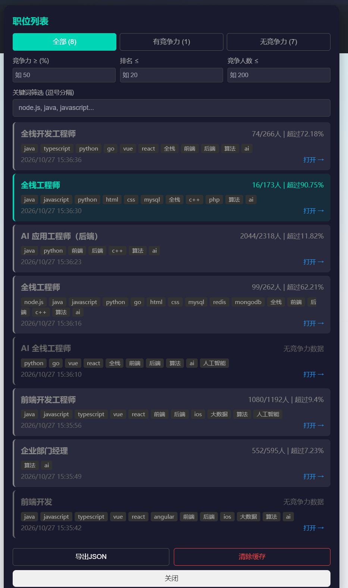
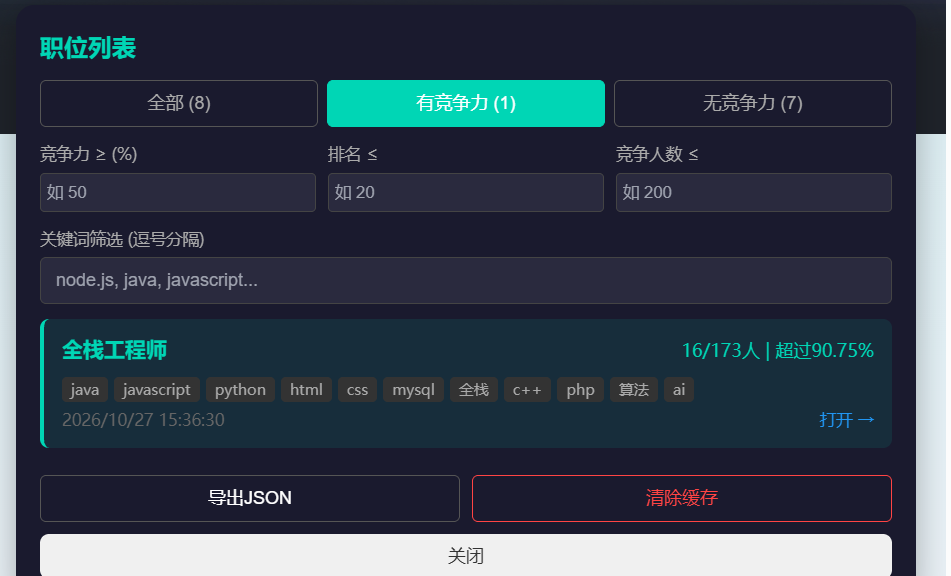

# BOSS直聘竞争力筛选器

Tampermonkey 油猴脚本，自动分析你在 BOSS直聘 上每个职位的竞争力排名，筛选出你有优势的岗位。

## 功能

### 工具栏


### 自动采集竞争力数据

- 打开职位列表页，点击「自动采集」按钮
- 脚本逐个打开职位详情页，提取竞争力排名数据（排名/总人数/百分位）
- 采集完成后自动关闭标签页，返回列表继续下一个
- 支持滚动加载，自动发现新职位并加入采集队列
- 数据缓存 24 小时，过期自动清理

### 列表页标记

- 已采集的职位卡片右上角显示竞争力徽章
- 绿色：有竞争力（排名前 10 或超过 90% 竞争者）
- 灰色：竞争力不足
- 悬浮显示详细排名信息

### 职位列表面板

点击工具栏「查看职位列表」打开筛选面板，支持：

| 筛选条件 | 说明 |
|---------|------|
| 竞争力 ≥ (%) | 百分位下限，如填 50 只看超过 50% 竞争者的职位 |
| 排名 ≤ | 排名上限，如填 20 只看排名前 20 的职位 |
| 竞争人数 ≤ | 总竞争人数上限，如填 200 只看 ≤ 200 人竞争的职位 |
| 关键词筛选 | 逗号分隔，匹配职位标题和详情页提取的技术关键词 |

- 快速切换：全部 / 有竞争力 / 无竞争力
- 导出 JSON：导出所有缓存数据
- 清除缓存：清空所有已采集数据





### 技术关键词自动提取

采集详情页时自动识别技术栈关键词（Java、Vue、React、Python、Go、AI 等 40+ 常见技术），用于关键词筛选。

## 安装

1. 浏览器安装 [Tampermonkey](https://www.tampermonkey.net/) 扩展
2. 点击 Tampermonkey 图标 → 添加新脚本
3. 将 `boss-competitive-filter.user.js` 内容粘贴进去，保存
4. 打开 BOSS直聘 职位搜索页面即可使用

## 工作原理

```
列表页 (www.zhipin.com)          详情页 (m.zhipin.com iframe)
       │                                │
       │  1. 打开详情页新标签页           │
       │───────────────────────────────>│
       │                                │  2. 提取排名数据
       │                                │  (rank/total/percentile)
       │  3. postMessage 回传数据        │
       │<───────────────────────────────│
       │                                │
       │  4. 缓存数据 + 标记卡片          │
       │  5. 2秒后自动关闭标签页          │
       │───────────────────────────────>│
```

- 详情页通过移动端 iframe (`m.zhipin.com`) 获取竞争力数据
- 同时拦截 XHR/Fetch 响应作为备用数据源
- 所有数据通过 URL 作为 key 缓存在 Tampermonkey 的 `GM_setValue` 中

## 配置

脚本顶部 `CONFIG` 对象可调整：

```javascript
const CONFIG = {
    topRankThreshold: 10,        // 排名前 N 视为有竞争力
    percentileThreshold: 90,     // 百分位 ≥ N% 视为有竞争力
    cacheExpireMs: 86400000,     // 缓存过期时间（默认 24 小时）
};
```

## 注意事项

- 需要浏览器允许弹出窗口（自动采集需要 `window.open`）
- 建议采集时不要频繁切换标签页，等待脚本自动关闭
- 缓存数据存储在浏览器本地，清除浏览器数据会丢失
